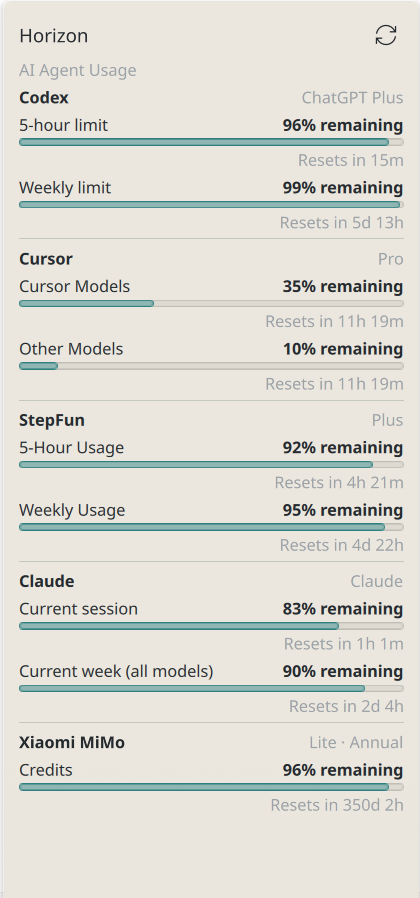
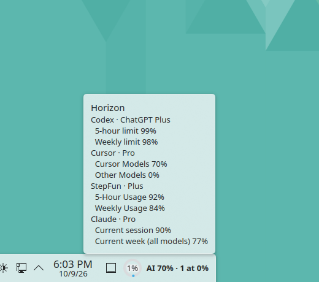
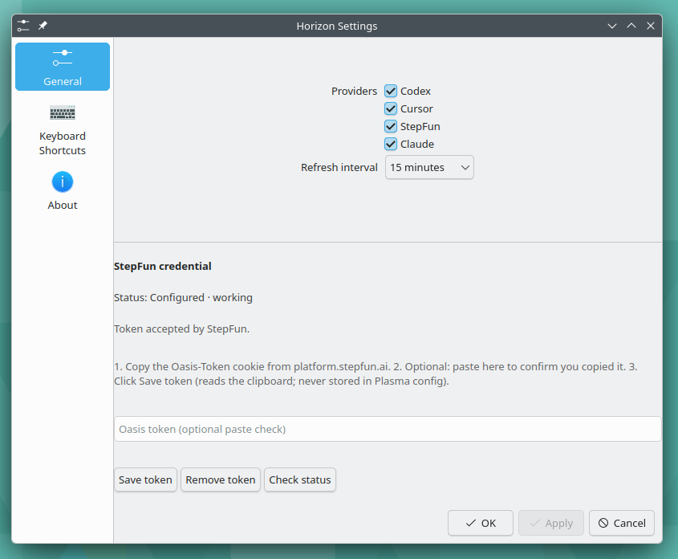

# Horizon

**Horizon shows the remaining quota of the AI coding tools you already use, directly in KDE Plasma.**

Horizon is a KDE Plasma widget for Linux that keeps an eye on OpenAI Codex (ChatGPT Plus), Cursor, Claude, the StepFun Step Plan, and the Xiaomi MiMo Token Plan, so you can see when you are close to a limit without opening separate dashboards.

Compact panel: the lowest remaining quota. A meter at 0 is counted beside that number (`AI 75% · 1 at 0%`) instead of replacing it. When every meter is at 0 the panel shows `AI 0%`.
Popup: one section per provider with its plan, one row per remaining-quota meter with that meter's own reset, and clear stale / auth / error labels. Hover the panel for each meter's label.





Product page and release overview: [Radilabs Horizon](https://www.radilabs.com/horizon/)

## Features

- Panel widget showing the lowest remaining quota, with a separate count when some meters are exhausted
- Expanded popup with one section per provider, a plan when known, and one row per remaining-quota meter with its own reset
- Codex, Cursor, Claude, StepFun Step Plan, and Xiaomi MiMo Token Plan support
- Per-provider enable/disable with a configurable refresh interval (default 15 minutes)
- Background refresh with per-provider overlap protection (Xiaomi MiMo is manual refresh only)
- Stale, authentication, and provider-error labels instead of silent failures
- StepFun Oasis token stored only in KWallet, with at most one automatic refresh attempt per fetch
- Xiaomi MiMo `tp-` key stored only in KWallet, fetched only when you press Refresh
- Local usage cache holding normalized, non-secret data only
- No telemetry, analytics, or cloud sync

## Who it is for

Horizon is for developers who use AI coding services on Linux with a KDE Plasma desktop and need remaining quota at a glance. It suits everyday Codex, Cursor, Claude, StepFun, and Xiaomi MiMo users who prefer one always-visible panel entry over checking several provider dashboards.

Horizon is intentionally **not** a provider login client, an OAuth broker, a browser extension, or a quota forecasting tool. It reuses the credentials you already have on this machine.

## Supported providers

| Provider | Auth |
|----------|------|
| **OpenAI Codex** (ChatGPT Plus) | Reuses `~/.codex/auth.json` |
| **Cursor** | Reads the IDE session (`state.vscdb`) and the CLI file (`~/.config/cursor/auth.json`) read-only |
| **Claude** (Pro/Max) | Reads Claude Code credentials read-only |
| **StepFun Step Plan** | User-supplied Oasis token stored only in **KWallet** |
| **Xiaomi MiMo Token Plan** | User-supplied `tp-` key stored only in **KWallet**; manual refresh only |

Horizon does **not** implement provider login/OAuth, browser cookie import, or password storage.

## Install

Current release: **0.2.1** — [GitHub release v0.2.1](https://github.com/radilabs/horizon/releases/tag/v0.2.1) · [Radilabs Horizon page](https://www.radilabs.com/horizon/)

Dependencies: Plasma 6, Python 3, Python D-Bus (`python3-dbus`) for KWallet, and a clipboard tool (`wl-paste` on Wayland, or Klipper via `qdbus6`) for the optional settings token entry.

```bash
git clone https://github.com/radilabs/horizon.git
cd horizon
git checkout v0.2.1        # release tag; omit for the current tip of main
./scripts/install.sh
```

This installs:

* collector to `~/.local/share/horizon/collector/`
* launcher to `~/.local/bin/ai-usage` (not a symlink into the git checkout)
* plasmoid `com.radilabs.horizon`

Add **Horizon** from the Plasma widget picker.

If Horizon is already on the panel and does not show the new popup or compact text, reload Plasma:

```bash
plasmashell --replace
```

You can also log out and back in. If the widget disappears, add it again from the widget picker. `scripts/upgrade.sh` runs `scripts/install.sh`, which prints the same hint.

Upgrade / uninstall:

```bash
./scripts/upgrade.sh
./scripts/uninstall.sh          # keeps KWallet token + usage cache
./scripts/uninstall.sh --purge  # also removes usage cache; still keeps KWallet token
```

There is no CI release pipeline: the git tag plus `scripts/install.sh` is the supported install path. Details: [docs/release.md](docs/release.md).

## Configuration

Widget settings (right-click → Configure Horizon):

* Enable/disable **Codex**, **Cursor**, **StepFun**, **Claude**, **Xiaomi MiMo**
* Refresh interval: 5 / 10 / **15** / 30 / 60 minutes (default 15)
* StepFun token management
* Xiaomi MiMo region and `tp-` key management



Disabled providers are not queried, refreshed, shown, or included in the compact summary. Disabling does **not** delete credentials.

## Authentication

### Codex

Sign in with the Codex/ChatGPT tooling so `~/.codex/auth.json` exists. Horizon reuses it.

```bash
ai-usage status codex --json
```

### Cursor

Horizon reads two Cursor-owned files and never modifies or refreshes them. It sends the IDE `cursorAuth/accessToken` only when that value is a JWT. Otherwise, and when the usage API rejects that token, it uses the `accessToken` in `~/.config/cursor/auth.json`. Sign in with the Cursor CLI (`agent`) so that file exists. A sign-in in the desktop app alone can leave an opaque session value that Horizon will not send.

```bash
ai-usage status cursor --json
```

### Claude

Stay signed in with Claude Code so `~/.claude/.credentials.json` exists. Horizon reads that file and does not refresh or rewrite it. If the session is missing or rejected, sign in again with Claude Code.

```bash
ai-usage status claude --json
```

### StepFun

Paste an existing Oasis token (from a StepFun web session). Stored only in KWallet. If the stored pair is still accepted by StepFun’s unofficial refresh endpoint, Horizon performs **one** automatic refresh and writes KWallet only after a live usage check succeeds.

```bash
ai-usage auth stepfun set      # secure prompt; no --token flag
ai-usage auth stepfun status   # working | auth_failed | missing
ai-usage auth stepfun clear
ai-usage status stepfun --json
```

Or use **Widget settings → StepFun credential**:

1. Copy the `Oasis-Token` cookie from `platform.stepfun.ai`
2. Click **Save token** (optional: paste into the field first as a visual check)
3. Confirm status is `Configured · working`

Status is `Configured · working` only after StepFun accepts the token — not merely that something is stored. The token is never written to Plasma config or the usage cache.

### Xiaomi MiMo

Copy your Token Plan `tp-` key from the Xiaomi MiMo console. Stored only in KWallet. Choose the region (`sgp`, `cn`, or `ams`) that the key was issued for; a wrong region looks the same to Xiaomi as a wrong key.

```bash
ai-usage auth mimo set        # secure prompt; no --token flag. prints invalid if the shape check fails
ai-usage auth mimo status     # working | auth_failed | unavailable | missing
ai-usage auth mimo clear
ai-usage status mimo --json
```

Or use **Widget settings → MiMo credential**:

1. Copy the `tp-` key
2. Click **Save key** (optional: paste into the field first as a visual check)
3. Confirm status is `Configured · working`

MiMo is **manual refresh only**. The refresh interval, widget startup, opening the popup, and changing settings never fetch it: use the **Refresh** button or `F5`. Xiaomi's Token Plan terms restrict the quota to programming tools, so Horizon leaves unattended polling to you. MiMo is disabled by default; enable it in settings first.

## Security

* Prefer provider-owned credentials (Codex, Cursor, Claude). Cursor credentials stay read-only (ADR-0007, ADR-0013). Claude credentials stay read-only (ADR-0011)
* StepFun token: OS credential store only (ADR-0009); bounded Oasis refresh write-back (ADR-0010)
* Xiaomi MiMo `tp-` key: OS credential store only (ADR-0009). Never read from the environment, shell profiles, or MiMo-Code files. Manual refresh only
* Usage cache (`~/.cache/horizon/usage-*.json`): normalized non-secret data only
* No telemetry / analytics / cloud sync

See [docs/security.md](docs/security.md).

## Known limitations

Quota APIs for these tools are **unofficial** and can break when providers change endpoints or auth. The Xiaomi MiMo Token Plan endpoint is official and is the one exception. Details:

* [docs/providers/codex.md](docs/providers/codex.md)
* [docs/providers/cursor.md](docs/providers/cursor.md)
* [docs/providers/stepfun.md](docs/providers/stepfun.md)
* [docs/providers/claude.md](docs/providers/claude.md)
* [docs/providers/mimo.md](docs/providers/mimo.md)

Architecture: [provider-contract](docs/provider-contract.md), [usage-schema](docs/usage-schema.md), [cache](docs/cache.md).  
Development notes: [docs/development.md](docs/development.md).  
Release process: [docs/release.md](docs/release.md).

Version: **0.2.1**

## License

Horizon is available under the [Apache License 2.0](LICENSE). Copyright © Radilabs.
